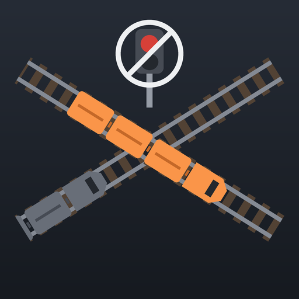

# Auto Trains

A Satisfactory mod for train traffic without block or path signals. Every self-driving train reserves the track
ahead of it and speeds up, slows down, waits or reroutes so that no two trains ever need the same track at the same
time. Trains never stop inside a junction someone else needs, can follow each other through roundabouts, and take a
less busy route when theirs is congested.

- Existing signals are ignored while traffic control is on; `/at removesignals confirm` removes them all.
- Optional: colliding trains pass through each other instead of derailing.
- Works with DynamicTimeTable and Freight Car Control; replaces DynamicTrainRoutes.
- Nothing is written into save data; turning traffic control off (or uninstalling) gives trains back to signals.

- Mod page text and changelog: [Docs/Release](Docs/Release)
- How the traffic works, a test checklist and every `/at` command: [Docs/Testing.md](Docs/Testing.md)
- Logs, telemetry and fix history: [Docs/Debugging.md](Docs/Debugging.md)
- Icon: `python Tools/make_icon.py`
- Build: place the folder in the SML starter project's `Mods` folder and package it with Alpakit (Windows, Windows
  server and Linux server targets)
